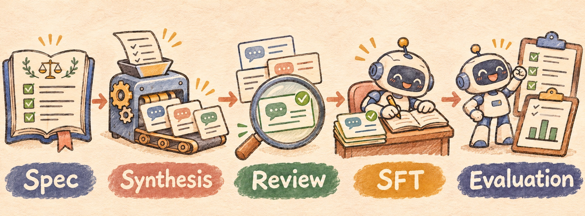
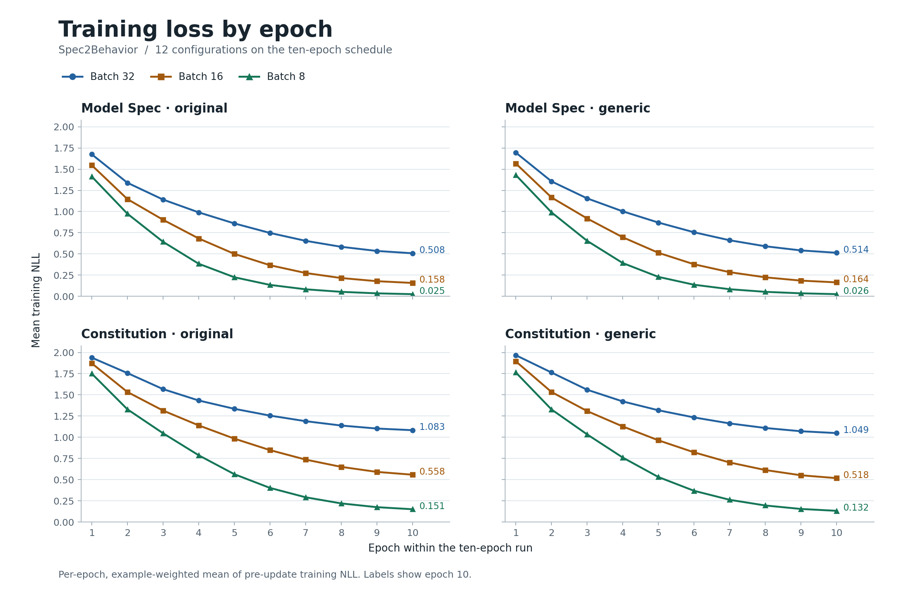
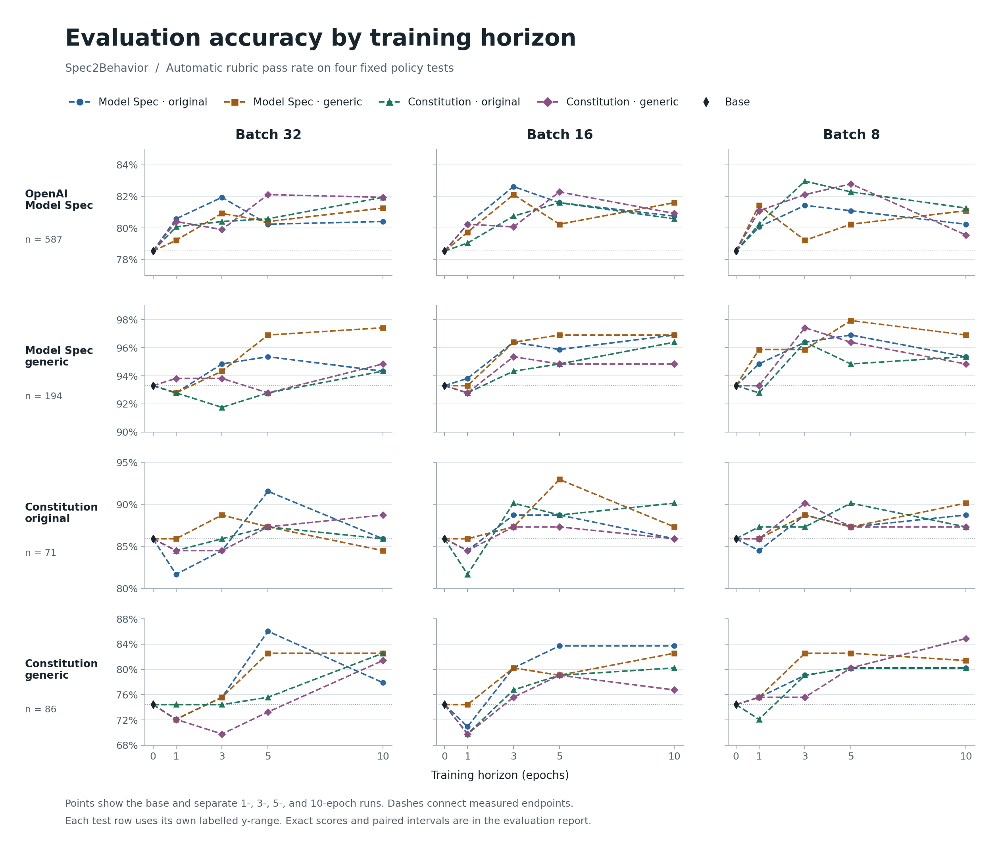

# Spec2Behavior



Spec2Behavior synthesizes training data and fine-tunes models from written behavioral specifications, using model specs and constitutions as sources and [Tinker](https://tinker-docs.thinkingmachines.ai/) for training.

## Training and evaluation results

The [10-epoch reference experiment](#default-sft-experiment) covers four training collections and three batch sizes. Each model is evaluated on 938 cases across four fixed policy tests.

Training loss fell through epoch 10 for all twelve configurations. In the 48 matched comparisons against five epochs, automatic pass rates rose in 20, fell in 21, and tied in 7. The highest ten-epoch pass rate was lower than the highest five-epoch rate on each test.

### Training loss

Each point averages the pre-update training NLL over the examples in that epoch of the ten-epoch schedule. The labels at the right show epoch 10.



### Evaluation accuracy

Accuracy is the automatic rubric pass rate on the four fixed tests, using GPT-OSS-120B as a rubric-only judge. A score of 6 or 7 out of 7 counts as a pass. The dashed lines connect the base and independently trained 1-, 3-, 5-, and 10-epoch endpoints. Each test row uses its own labeled y-axis range.



On one reviewed control item, the judge marked 10 of 12 ten-epoch replies as failures despite those replies meeting the rubric. The curves retain the original automatic scores.

[Training loss CSV](assets/epoch-sweep/training-loss.csv) · [Evaluation accuracy CSV](assets/epoch-sweep/evaluation-accuracy.csv) · [Reproduce the experiment](#default-sft-experiment) · [Earlier thirteen-model comparison](evaluation/results/nemotron-lightning/README.md)

## Quick start

Use Python 3.11 or newer and run the commands from a clone of this repository. The bundled data and upstream snapshots are part of the checkout.

```bash
git clone https://github.com/bebetterest/spec2behavior.git
cd spec2behavior
python -m venv .venv
source .venv/bin/activate
python -m pip install -e .

python -m synthesis list
python -m evaluation.datasets
```

These commands need no API credentials. For the ten-epoch training and evaluation workflow, start with the [reference experiment](#default-sft-experiment). Install `.[dev]` to run the tests with `python -m pytest`.

## Layout

| Path | What it is |
|---|---|
| `synthesis/` | API synthesis runner. A chain is `read`, `prompt`, and `parse` |
| `synthesis/templates/` | Six default chains that turn rule excerpts into SFT rows |
| `training/` | Tinker SFT and inference over the synthesized conversations |
| `evaluation/` | Evaluation tooling, overlap screening, cost preparation and aggregate research results |
| `data/` | SFT candidates, reviewed conversations, four evaluation collections, and provenance |
| `assets/epoch-sweep/` | Figures and aggregate tables for the reference experiment |
| `generic/` | Markdown inputs used by the synthesis examples |
| `model_spec/` | Snapshot of the OpenAI Model Spec |
| `claude-constitution/` | Snapshot of Claude's constitution |
| `model_spec_evals/` | Snapshot of OpenAI's Model Spec eval harness |

## Synthesis

A chain is three functions in a Python file. `read` yields records, `prompt` turns one record into the model request, and `parse` turns the reply into SFT conversations. `synthesis/templates/` holds six default chains. Each one reads the direct body under each heading in a Markdown spec or constitution, splitting long bodies on paragraph boundaries. Copy one and edit those functions, then pass the file with `--template`. The runner calls an OpenAI-compatible chat completions API, runs requests in batches with a concurrency limit, and resumes from JSONL checkpoints.

Preview one request locally. Run `python -m synthesis run rule_examples --help` for the available settings.

```bash
python -m synthesis run rule_examples \
  --source generic/model_spec.md \
  --output runs/model-spec/rule-examples-deepseek \
  --limit 1 \
  --max-retries 0 \
  --dry-run
```

For live synthesis, put `DEEPSEEK_API_KEY` in the ignored `.env` using [.env.example](.env.example) and remove `--dry-run`. CLI flags override environment variables, which override `.env`. Use `--env-file FILE` to select another file. Repeat the command to resume or remove `--limit 1` to process all pending excerpts.

The other default chains are `correction`, `reflection`, `pressure`, `chain_of_command`, and `safe_completion`. They share `--source` and write different `sft_form` values.

Defaults are the DeepSeek API with `deepseek-flash` and thinking on, a 16000-character input target, a 16384-token output budget, temperature 1.0, and one request/reply pair for `rule_examples` (one `generate` and one `act` training row). Override them with `--provider`, `--model`, `--thinking`, `--max-portion-chars`, `--max-tokens`, `--temperature`, and `--examples`. `--help` lists the settings. Use a separate output directory for each source and chain.

Each excerpt/template combination produces one candidate. Every new candidate's prompt starts with `Random seed: <32 random hex characters>` to encourage varied scenarios and wording. The value is recorded as `generation_seed` in API events, job/error records, and SFT metadata, and is excluded from training messages. HTTP retries reuse the request and seed; generating a candidate again creates a new seed. A dry-run seed is only a preview. This prompt hint does not guarantee different outputs or deterministic replay.

Switch APIs with `--provider deepseek`, `--provider openrouter`, or `--provider openai`, using `DEEPSEEK_API_KEY`, `OPENROUTER_API_KEY`, or `OPENAI_API_KEY` respectively, and select that provider's model with `--model`. DeepSeek and OpenRouter default to thinking on; `--thinking off` disables it and `--thinking default` leaves the choice to the server. OpenAI keeps its server default when the flag is omitted. `--provider auto` keeps the existing `--base-url` / `OPENAI_BASE_URL` setup. See [synthesis settings](synthesis/README.md#run) for examples.

`runs/model-spec/rule-examples-deepseek/train.jsonl` is chat JSONL. Each line has `messages` plus `id`, `job_id`, and `meta`. New row ids include the chain name so different templates can be combined. Tinker Cookbook's `FromConversationFileBuilder` trains on `messages`.

Each run also keeps `api.jsonl`: the complete request JSON and raw response text for every HTTP attempt, including retries and failures, linked by job and call ids. Returned thinking and usage remain available there; SFT uses only final answers. Credentials are omitted or redacted. Raw run outputs stay local under the ignored `runs/` directory.

Parsing validates structure, not semantic correctness. Review generated conversations for rule compliance and invented facts, then save the accepted rows to a separate file such as `runs/model-spec/reviewed/train.jsonl`. Keep that file outside the generator's output directory: resume rebuilds its `train.jsonl` from the original jobs.

Pipeline details, output files, and how to add a chain are in [synthesis/README.md](synthesis/README.md).

## Bundled data

[Four source-specific SFT collections](data/README.md) contain **5,624 reviewed conversations**: 1,897 Model Spec generic, 1,909 Model Spec original, 932 Constitution generic, and 886 Constitution original. Select a collection explicitly when training. Original/generic variants share source material and are not independent held-out datasets.

The earlier generic-source mixture is also preserved: [data/candidates.jsonl](data/candidates.jsonl) contains 3,170 original conversations from four synthesis rounds over the generic Model Spec and constitution. [data/reviewed.jsonl](data/reviewed.jsonl) contains its 2,829 accepted conversations after semantic review, targeted checks, and selected Codex adjudication; accepted messages and IDs are unchanged. Use the reviewed file for SFT: the original candidates contain known defects, and the loader does not filter by review metadata. This is model-assisted curation, not human certification or evidence of training performance. [The dataset guide](data/README.md) describes the review criteria, provenance, checksums, and offline validation.

## Training and inference

The general-purpose SFT command uses Tinker Cookbook. Inference samples with the same chat renderer and can read the newest sampler checkpoint from the training log. The example below is a dry-run smoke test. See the [default SFT experiment](#default-sft-experiment) for the DiMuon reference recipe.

```bash
python -m training sft \
  --data data/variants/model-spec-generic/reviewed.jsonl \
  --log-dir logs/model-spec \
  --model Qwen/Qwen3-8B \
  --batch-size 1 \
  --dry-run
```

For live training, install `.[train]`, set `TINKER_API_KEY` in the environment, and remove `--dry-run`. After training produces a sampler checkpoint, run inference with the same environment.

```bash
python -m training infer \
  --log-dir logs/model-spec \
  --input data/variants/model-spec-generic/reviewed.jsonl \
  --output logs/model-spec/infer
```

Flags, resume behavior, and the prediction file are in [training/README.md](training/README.md).

## Evaluation datasets

[Four fixed test collections](data/evaluation/README.md) contain **938 conversation/rubric records**: OpenAI Model Spec original **587**, Model Spec generic **194**, Claude Constitution original **71**, and Constitution generic **86**. The official set targets the 2025-12-18 Model Spec; the generic Model Spec source is 2026-08-18. Synthetic cases have explicit source-grounded model/Codex review, not independent human certification. These are separate from SFT data.

Verify their counts and checksums offline with `python -m evaluation.datasets`. [The manifest](data/evaluation/manifest.json) records portable paths, versions, provenance and checksums. Requests, replies, decisions and runtime records remain local.

## Default SFT experiment

Spec2Behavior uses **10 epochs** as the default schedule for its reference SFT experiments. The sweep crosses four [reviewed training collections](data/README.md) with three batch sizes, for twelve configurations. Each configuration starts from the same base model and trains on one collection.

| Setting | Value |
| --- | --- |
| Base model | `nvidia/NVIDIA-Nemotron-3.5-Lightning-30B-A3B-BF16` |
| Renderer | `nemotron3_ultra_preserve_thinking` |
| Epochs | 10 |
| Batch sizes | 8, 16, 32 |
| LoRA rank | 64 |
| Optimizer | DiMuon v1, `beta1=0.9`, gradient clipping disabled |
| Learning rate | `1e-3`, linear decay over the full schedule |
| Training objective | Cross-entropy on all assistant messages, averaged per example |
| Data order | Shuffle seeds 0 through 9, with partial final batches retained |

Use the [reference training runner](training/README.md#reference-experiment) and the [fixed policy evaluation commands](evaluation/README.md#reproduce-the-reference-epoch-sweep) to reproduce the experiment from a checkout. Set credentials in the environment or the ignored `.env` using [.env.example](.env.example).

## Published evaluation results

[The Nemotron Lightning comparison](evaluation/results/nemotron-lightning/README.md) covers the unadapted vendor base and twelve SFT checkpoints across **938 cases per model**. It includes a 52-row CSV, dataset/training hashes, the exact grading settings, paired intervals and selected judge-quality findings. Primary automatic scores are preserved; this is an experimental result summary with known measurement errors, not a validated model ranking.

```bash
python -m evaluation.published_results
```

This offline command checks the published file hashes, model/dataset combinations, metric arithmetic, diagnostics and table consistency. It makes no inference calls. The [evaluation guide](evaluation/README.md) distinguishes the upstream comparison CLI from the synthetic task helper and documents their grading-validation differences.

## Generate evaluation data

[The evaluation builder](evaluation/builder/README.md) constructs source-grounded conversation/rubric candidates for the other three spec collections, with source review, independently authored probes, bounded revision, SFT-overlap screening and explicit reviewed export. Install its dependencies with `python -m pip install -e '.[evalgen]'`. The default configuration plans up to six cases. Raw API evidence and review records remain under ignored local directories.

## License

Project-authored code and accompanying documentation use the [MIT License](LICENSE). The [dataset license](data/LICENSE.md) lists the synthetic datasets available under CC BY 4.0 and gives a suggested attribution.

The upstream [Model Spec](model_spec/LICENSE), [Claude Constitution](claude-constitution/LICENSE), and [official Model Spec test data](data/evaluation/LICENSE-model-spec-dataset.txt) are CC0-1.0. The upstream [Model Spec eval harness](model_spec_evals/LICENSE) uses the MIT License.
